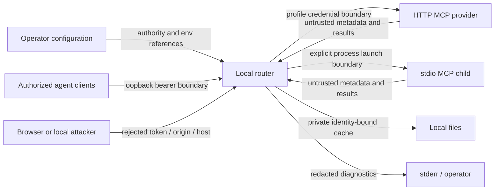

# Generic router threat model and security contract

## Scope and evidence

Design-stage model for the user-authorized generic local MCP tools CLI. Evidence: [plan.md](plan.md), criteria 1–14, and coordinator handoff dated 2026-10-10. No implementation controls are evidenced yet; every mitigation below is a requirement to prove, not a vulnerability finding. No real credentials, live providers or private Context7 files were inspected.

Runtime scope: same-operator clients → authenticated loopback gateway → configured HTTP upstream or explicitly configured local child process → private disk cache. Build/dev scope: repository, SDK dependency, package archive and authorized public GitHub source. Test scope: synthetic credentials and mock SDK servers only. OAuth, remote hosting, browser UI and advanced bidirectional protocol callbacks are excluded.

## Assets and actors

Protect upstream credentials, tool result confidentiality, profile/argument integrity, mutation semantics, local files, and provider quota. Legitimate operator may launch configured executables and assign tool policies. Authorized clients share the operator's gateway authority; this is not per-client tenant isolation.

Adversaries: an unauthenticated local process or browser origin reaching loopback; an upstream supplying misleading annotations, reflected secrets or arbitrary tool content; an authorized client issuing costly or mutating calls; an actor able to place symlinks in an otherwise writable state path; accidental release of private artifacts. A process already controlling this OS user can read its credentials and change configuration, so the router cannot defend against full same-user compromise. Configured stdio children are trusted executables with user privileges, not sandboxed untrusted code.

## Entry points and trust boundaries

| Edge | Inputs / authority | Contract |
| --- | --- | --- |
| Operator → configuration | Endpoints, executable argv, env references, profile order, named tool policy | Validate before launch; no inferred read-only permission. Operator controls authority. |
| Agent/browser/local process → gateway | MCP requests, bearer token, Host and Origin | Loopback bind plus bearer validation on every request, Host restriction, reject disallowed Origin. No inbound bearer passthrough. |
| Router → HTTP provider | Separately resolved profile headers; tools/list and tools/call | Send intended identity only; 401/403 never change profile automatically. |
| Router → stdio child | Explicit executable argv and profile-specific environment | Treat launch as operator-approved execution. Do not construct shell commands from tool input. |
| Upstream → policy/result | Schemas, annotations, errors and content | Metadata is untrusted; readOnlyHint never authorizes retry. Explicit safeTools is operator-reviewed policy, not automatic side-effect detection. Content forwarded as tool data, never executed by router. |
| Router → cache/files | Identity key, args, result, TTL, token/config paths | Separate identities, no secret key material, private modes, reject symlinks, corrupt entries miss. |
| Runtime/dev → diagnostics/release | Reflected provider errors, logs, package and history | Omit configured secrets; release contains synthetic fixtures only. |

## Threats

| ID | Actor / entrypoint / abuse path | Asset | Existing control and evidence | Likelihood / impact / priority | Assumption |
| --- | --- | --- | --- | --- | --- |
| THREAT-01 | Browser or local process calls loopback without authority or uses rebinding Host | Upstream credentials and tool actions | None implemented; AC 12 requires guards | Medium: local endpoints reachable; High: provider actions; High | Gateway remains loopback and clients share one operator authority |
| THREAT-02 | Upstream labels mutating tool read-only; retry duplicates mutation or 401 triggers stronger identity | Mutation integrity and account authority | None implemented; AC 4, 7, 8 specify explicit policy | Medium: metadata is provider-controlled; High: duplicate actions; High | Operator truthfully classifies tool side effects |
| THREAT-03 | Cache/coalescing key ignores profile, endpoint, args or tool name | Result confidentiality/integrity | None implemented; AC 5, 6 | Medium: common key omissions; High if results are private; High | Configured effective identity corresponds to real provider authorization |
| THREAT-04 | Writable path replaced with symlink; permissive file leaks cache/config or overwrites target | Credentials, results and local files | None implemented; AC 11 | Medium: state path can be supplied; High: disclosure/overwrite; High | Full OS-user compromise remains outside boundary |
| THREAT-05 | Provider reflects credential in error; operator publishes log or secret-containing package | Credentials | None implemented; AC 13, 14 | Medium: errors and releases are common; High: credential leakage; High | Redaction covers configured values, not arbitrary unknown secrets inside tool results |
| THREAT-06 | Client issues repeated eligible quota errors or child stalls; router/SDK amplifies retries or strands pending work | Quota and availability | None implemented; AC 3, 6, 7, 8 bound actual calls and require cleanup | Medium: authorized clients can call tools; Medium: local service exhaustion; Medium | No general rate limiter or provider-spend guarantee is promised |
| THREAT-07 | Operator config points at malicious stdio executable or compromised dependency | OS-user files/network/environment | Explicit trusted launch is design scope; no sandbox control | Low if operator provenance holds; High if executable compromised; Medium conditional | Operator owns executable/dependency trust; router is not a sandbox |

## Recommended mitigations

| Threat | Owner / change | Verification |
| --- | --- | --- |
| THREAT-01 | Gateway validates bearer, Host and Origin before MCP dispatch; bind loopback only | SEC-02 denial table plus an authorized SDK call |
| THREAT-02 | Policy owner permits retry/cache only for explicit named read-only tools; exclude auth failures | SEC-04 mutation and 401/403 counter tests |
| THREAT-03 | Cache/pending owner includes server, effective credential identity, tool and canonical args | SEC-05 isolation and simultaneous identity cases |
| THREAT-04 | File owner uses private modes and no-follow validation for existing paths and writes | SEC-01 symlink target remains untouched |
| THREAT-05 | Diagnostics owner sanitizes configured values and sensitive headers; release owner scans artifacts/history | SEC-03 synthetic canary errors and package/history inspection |
| THREAT-06 | Retry owner tries each profile once; pending work cleared on failure; gateway shutdown closes children | AC 3, 6, 7 counted requests and process cleanup |
| THREAT-07 | Config parser accepts explicit argv, launches without shell; docs explain trusted child privilege | AC 10 invalid config; inspect production launch path and dependency provenance |

## Security surfaces

Configuration, CLI diagnostics, shared HTTP MCP route, upstream HTTP/stdio adapters, tool metadata/results, private cache/config files, public package and Git history. No remote multi-user tenancy or live credential acquisition.

## Abuse cases

| ID | Actor / steps / adverse outcome | Requirement |
| --- | --- | --- |
| ABUSE-001 | Unauthenticated process, foreign Origin or malicious Host calls local gateway and triggers provider work | SEC-02 |
| ABUSE-002 | Provider metadata advertises readOnlyHint for a mutation; quota or auth error changes identity and repeats side effect | SEC-04 |
| ABUSE-003 | Authorized call uses another profile/server/args but receives earlier cached or pending result | SEC-05 |
| ABUSE-004 | Symlinked directory or file redirects credential/cache write or exposes permissive file | SEC-01 |
| ABUSE-005 | Synthetic secret reflected in provider error is printed or committed in release artifact | SEC-03 |

## Security requirements

| ID | EARS requirement / plan criteria | Abuse |
| --- | --- | --- |
| SEC-01 | The router SHALL keep private directories 0700/files 0600 and reject symlinked private paths without modifying their targets (AC 11). | ABUSE-004 |
| SEC-02 | IF bearer, Host or Origin is unauthorized THEN the gateway SHALL deny access before upstream invocation; authorized loopback requests SHALL succeed (AC 12). | ABUSE-001 |
| SEC-03 | WHEN configured credentials enter diagnostics or release preparation THEN the router/deliverable SHALL expose zero configured secret values in diagnostics and zero user private files in package/history (AC 13, 14). | ABUSE-005 |
| SEC-04 | IF tool policy is absent or provider status is 401/403 THEN the router SHALL make one actual upstream attempt and zero automatic retries/profile failover, including quota-matching auth error text (AC 4, 8). | ABUSE-002 |
| SEC-05 | WHEN server, effective profile identity, tool or canonical arguments differ THEN cache/pending results SHALL remain separate (AC 5, 6). | ABUSE-003 |

## Negative-test seeds

| SEC / abuse | Setup and action | Negative result / authorized control |
| --- | --- | --- |
| SEC-01 / ABUSE-004 | Synthetic private state; symlink parent, config, token/cache record to external sentinel; start/write | Reject and sentinel unchanged; ordinary state obtains 0700/0600 |
| SEC-02 / ABUSE-001 | Mock provider count; missing/wrong token, foreign Origin, disallowed Host | Denial and zero upstream calls; valid bearer plus accepted Host/Origin succeeds |
| SEC-03 / ABUSE-005 | Canary keys in env/header/config and reflected HTTP/stdio errors; build package | No canary in stderr/diagnostic output, cache credential metadata or archive/history; safe diagnostic still identifies server/profile/error class |
| SEC-04 / ABUSE-002 | Tool advertises readOnlyHint=true but not policy-enabled; profile A yields quota/401/403 | One A attempt and zero B attempts; explicitly policy-enabled read tool with configured 429 reaches B once |
| SEC-05 / ABUSE-003 | Distinct profile/endpoint/tool/args markers and concurrent calls | No cross-marker cache/pending result; equivalent same-identity eligible calls invoke provider once |

## Assumptions, questions and limitations

User authorized generic local CLI/public source and delegated technical choices. Existing real accounts and private installation are outside this repository and must not be read or copied. Coordinator is settling transport/SDK literals; no material product question requires redundant user approval.

Same-operator clients intentionally share authority. A bearer token does not isolate authorized clients from each other. TTL caching cannot discover remote ACL revocation and may serve cached results up to configured TTL; operators should enable caching only where that staleness is acceptable and clear/disable cache after account access changes. Tool output may itself contain sensitive business data; diagnostics redaction does not rewrite arbitrary tool results, because fidelity is contracted. Profile identity rotation must invalidate prior identity entries. Filesystem guarantees cannot protect against full same-user compromise or guarantee atomic defense on every unsupported filesystem; supported-platform boundaries must be documented honestly.

HTTP redirects/discovery, arbitrary child sandboxing, rate limiting, cache size management and runtime budgets need honest implementation documentation if supported; this MVP does not claim them universally. Every identified boundary is modeled above; protocol extensions excluded in plan remain unmodeled. Threat rankings are conditional design risks, not confirmed source vulnerabilities. Recompute against landed code during independent verification.
